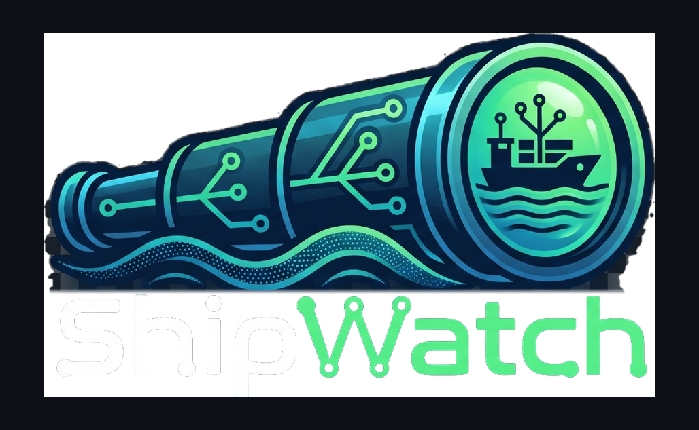

<p align="center"></p>

# Shipwatch

A [Claude Code](https://claude.com/claude-code) mod that shows every repo under a GitHub
account or org on one dashboard pane: running builds, open PRs, and a stepper that says
where each repo is in the loop from pull request to release.

```
my-app      ● PR ─ ◐ Build ─ ○ Merged ─ ○ Released
  #42 building · pushed 4m ago
  ▸ CI · feature/login
  ◐ #42 Add login screen
```

It is built for the workflow of pushing changes, letting CI build, then downloading the
release. With several apps going at once it answers "which of these is waiting on me?"

## What you get

- **A pane** (`/shipwatch`): one block per repo that needs attention, ordered failing,
  building, ready to merge, awaiting release. Stale repos (old conflicted drafts and the
  like) and quiet ones collapse to one line each.
- **A status line entry**: `◐ 2 building · ✗ 1 failing · 7 open PRs`.
- **Toasts** when a build passes or fails, and when a new release is published.
- **Auto-fix (opt-in)**: a broken default-branch build can wake an idle session with a
  fix request, so a failure after an auto-merge doesn't wait for you to notice.
- **A ship clock** on the report and in the standalone app: a real analog clock (the hands show the time) whose rim shows the last hour of work. A dot sits at the minute each PR was opened, for the last 60 minutes, coloured by where it stands now (merged, open with checks passing / running / failing, draft, closed), with a list beside it and a one-line count ("7 PRs opened in the last hour: 4 merged, 2 open (1 failing), 1 closed"). A dot drops off when its hour is up. The app re-reads the hour every minute.
- **A GitHub points readout** in the report's header: how many of GitHub's GraphQL points are left this hour (and how many were used since the page opened), turning amber under 30% and red under 10%. The app reads it every 30 seconds from the endpoint GitHub does not count.
- **Adaptive polling**: every 20 s while something builds, every 60 s otherwise.
  Press `r` in the pane to refresh now.

### The stepper

| Step | Meaning |
|---|---|
| PR | An open pull request exists |
| Build | Its checks are running, passing or failing |
| Merged | The change is on the default branch |
| Released | A release has been published at or after the default branch's head commit |

With an open PR the stepper follows the most urgent one (conflicts or failing checks, then
running, then ready). With none it follows the default branch.

**Drafts and "do not merge" PRs are set aside.** A draft PR, or one whose title says "do not merge", never leads
the stepper and never turns a repo red, and its checks are not announced. In the report and the app they are also
left out by default: repos whose only open PRs are set aside are hidden, such PRs are not listed against other repos,
and they do not appear on the clock. Tick **Include drafts** (remembered between visits) to see them; the box says how
many draft-only repos are hidden. The app's Merge button refuses a PR titled "do not merge" and hides it for drafts. In
the terminal pane a repo with only set-aside PRs shows its default branch's state if that needs attention, and otherwise
sits below the real work as "draft".

**Recently merged, and Quiet.** A repo with nothing to act on is **Recently merged** if its default branch was updated
in the last three days (the row says how long ago), and **Quiet** if nothing has moved for longer. The stepper's steps
are coloured as GitHub colours them: PR green (open), Build green / amber / red, Merged purple, Released blue.

**Cancelled and skipped runs are not failures.** GitHub's combined status counts a run that a
newer push cancelled as a failure. Shipwatch reads the individual checks instead: only a failed
or timed-out check fails, only an unfinished one is running, and a commit whose runs were all
cancelled or skipped shows no build state.

### Stats

The **Stats** button switches the pane to what you have shipped over the last 7, 30, 90, 180 or 365 days, 2 or
5 years, or all time (back to your first repo), across every repo the account owns. The ranges count back from
today, so "365 days" is the year up to now, not a calendar year:

- PRs merged, commits, lines changed (added and removed) and repos created, with a bar per
  author, a per-repo breakdown, a per-week trend and a line graph of commits over time (by day, week
  or month depending on the range, counted on the day each commit's PR merged).
- **Who it is attributed to.** Claude Code, Cursor and Copilot all commit and open PRs under
  your own account, so who opened a PR says nothing. Each commit is attributed by its author
  and its `Co-Authored-By` lines to You, or to the AI named there. Known AIs are recognized by
  name (Claude, Copilot, Cursor, Codex, Gemini and others); any other `[bot]` account is named
  by its own login; the `aiNames` option adds more. **Other people** is its own share: commits by
  humans who are not you, never other AIs. Chore bots (Dependabot and the like) are left out entirely.
- **You vs all AI, or you vs each AI.** One button folds every AI into one bar or splits them;
  each AI has its own switch, so you can compare you against just Claude, for instance.
- **It is a label, not a measurement of who typed the code.** "You" means a commit with no AI
  marker, which includes AI work committed without one. Lines are added and removed in commits,
  so a commit that rewrites an earlier one counts again.
- **Charts.** On the desktop app and the editor the Stats view draws a donut of who wrote what, stacked bars per repo and
  a per-week column chart and a line graph of commits as vector graphics, with a tooltip on every mark. The terminal has no vector drawing, so it keeps
  the text bars. The charts are SVG strings from `src/core/charts.ts`, so any outlet can draw the same ones.
- **Full report.** The **Full report** button writes one self-contained HTML page (no network, nothing beside it) to the
  temp folder and opens it in your browser: the dashboard and the stats with filters, sortable tables, the charts, a
  theme picker (the VisualAssault themes) and a click-through to look at one repo alone. It is the same code as the pane, in `src/core/report.ts`; its script is
  `src/report/client.ts`, bundled into `src/core/reportClient.generated.ts` by `node scripts/build-report.mjs`.

Merged PRs never change, so each is fetched once and kept (in the plugin's store, across
sessions); opening Stats again only asks for what is new. The first load of a long range can take
a minute (all time, a few), and the pane says how far along it is.

### Links

Most text in the pane is a link: the repo name, each stepper step, the headline, PR lines,
and the workflow runs in flight.

| Click | Goes to |
|---|---|
| Repo name | The repo |
| PR | The PR the stepper follows, else the repo's pull requests |
| Build | That PR's checks, else the default branch's workflow runs |
| Merged | The default branch's commits |
| Released | The latest release, else the releases page |
| Headline | The PR for a conflict or draft, otherwise the build page |
| A run in flight | That workflow run |

The engine refuses a whole pane if one link target is malformed, so every URL is checked
first (`https:`, printable ASCII, no `@`, spaces or dot segments). A URL that fails the check
just shows as plain text.

## Requirements

- Claude Code with function-hook plugins (the desktop Code tab or the CLI).
- The [`gh` CLI](https://cli.github.com/), signed in. Shipwatch runs `gh api` and never
  handles your token. If `gh` can't be run from where your session runs, set the
  `githubToken` option instead and it calls the GitHub API directly.

## Install

From GitHub, no clone needed:

```bash
claude plugin marketplace add gerp93/Shipwatch
claude plugin install shipwatch@shipwatch
```

Then start a new session and run `/shipwatch`. Set options with
`claude plugin configure shipwatch`.

To work on it instead, point Claude Code at a clone: `claude --plugin-dir /path/to/Shipwatch`,
or for sessions the desktop app starts, set `CLAUDE_CODE_PLUGIN_DIRS` (and
`CLAUDE_CODE_PLUGIN_DIR_WATCH=1` to reload on save) in the `env` block of `~/.claude/settings.json`.

## Options

| Option | Default | |
|---|---|---|
| `owner` | empty | User or org to watch. Empty means the account `gh` is signed in as. |
| `pollSeconds` | `60` | Refresh interval while nothing is building. |
| `maxRepos` | `40` | Most recently pushed repos to track (1-100). |
| `staleDays` | `14` | A repo with no push or PR activity for this long, and nothing building, moves to a collapsed Stale group (`s` toggles it). |
| `autoFix` | `false` | When a default-branch build goes from running to failing, queue a prompt in the session asking Claude to find the cause and open a fix PR (never a direct push). Starts its own turn once the session is idle. |
| `autoFixLimit` | `5` | Most fix prompts per session; one per failing commit. |
| `aiNames` | empty | Extra names to count as AI in Stats, comma-separated, besides the ones recognized automatically. |
| `includeForks` | `false` | Also track forks. |
| `ignoreRepos` | empty | Comma-separated repo names to skip. |
| `githubToken` | empty | Fallback when `gh` can't run. Needs read access to repos. |

Archived repos are always skipped.

## Layout

```
src/core/                    the logic, written once (see src/core/README.md): what each repo's
                             state is, who commits are attributed to, what to fetch, the caching.
                             Knows nothing about its host, so any front end can use it.
hooks/register.tsx           the Claude pane: wires the core to the engine (process, HTTP, store,
                             state) and paints it. The only place the engine's `$` appears.
.claude-plugin/plugin.json   manifest and options
types/index.d.ts             the engine's state contract; GENERATED from src/core/types.ts
scripts/sync-contract.mjs    writes (or --check verifies) that file
```

The split is deliberate: Shipwatch is meant to have more than one outlet (the pane today; a web
report or an app would share `src/core` unchanged). Logic belongs in the core; a front end only
supplies how to reach GitHub and how to draw.

Check and test with:

```bash
claude plugin validate .
claude plugin test .
node scripts/sync-contract.mjs --check                          # contract matches the core's types
npx -p typescript tsc --noEmit -p src/core/tsconfig.json        # the core stays pure
```

The last two run in CI too (`.github/workflows/checks.yml`).

## Limits

- `autoFix` only fires for plain owner, repo, branch and commit names (letters, digits,
  `. _ - /`). A name with anything else gets a toast and no prompt, because those names are
  controlled by whoever owns the repo and go into a prompt Claude acts on.
- It sees what GitHub's check rollup reports. A repo with no CI shows no build step.
- "Released" is judged by release date against the head commit, so a repo that doesn't
  publish a release for every merge shows "unreleased commits" once the merge is a few
  hours old.
- Whether the new build is installed on your machine isn't tracked yet.
- **GitHub's hourly allowance is shared.** GraphQL gets 5,000 points an hour per account, for everything signed in
  as you: every open Claude session running Shipwatch (each polls on its own), the `gh` CLI, the app. Shipwatch reads
  how much is left after each poll, stretches the wait as it runs down, and never spends the last 30% (kept for your
  other tools and `gh pr create`); the pane says so ("Polling every N s...", "Paused until ..."). If GitHub refuses
  anyway the message says what GitHub's own rate-limit status shows (points left and the reset time), and Shipwatch tries again at that
  reset time; it makes up no time of its own. Each extra open session still costs its own polls.

## Standards

Shipwatch follows [KVG_Standards](https://github.com/gerp93/KVG_Standards), specifically its
[Claude Code plugins](https://github.com/gerp93/KVG_Standards/blob/main/claude-plugins.md)
standard: CI runs `claude plugin validate` and `claude plugin test`, every push to `main` is
tagged and released automatically, and `version` is deliberately omitted from the manifest
so every commit is an update for installed copies.

## License

AGPL-3.0. See [LICENSE](LICENSE).

## The standalone app

`app/` is an Electron app that shows the same report as the **Full report** button, without needing a Claude
session: `View, Refresh` reads GitHub and rebuilds the page. It imports the core from `src/core` (nothing is
copied), supplying `gh`/HTTP and a JSON file in place of the mod engine.

Install it from the latest [release](https://github.com/gerp93/Shipwatch/releases/latest) (an installer per
operating system); the installed app updates itself (Help, Check for updates). To run it from source:

```bash
cd app
npm install
npm start
```

It uses the `gh` CLI you are signed in with, or `GITHUB_TOKEN`. Optional settings go in `config.json` in the app's
user-data folder (`%APPDATA%/Shipwatch` on Windows): `owner`, `includeForks`, `maxRepos`, `staleDays`, `aiNames`,
`ignore`. `SHIPWATCH_OWNER` overrides the owner.

**It opens on what it already knows.** The last dashboard it read is saved (`board.json` in the same folder), and the stats
history is saved too (`stats.json`), so the window shows both straight away on every start after the first. GitHub is
read behind it: a banner says the repos shown are saved ones being updated (or why the update failed and when it will try
again), and the page changes when the new data arrives, keeping your tab, filters and sort. Only the very first start,
when nothing is saved, shows a loading screen. After that the app also re-reads the dashboard by itself every couple of
minutes (slower as GitHub's allowance runs down) and Refresh never replaces the page with a loader.

The stats history loads in the background too, with a progress bar on the Stats tab and the numbers filling in as it
arrives. It is saved newest first as it loads, so closing the app or hitting a rate limit part way loses nothing, and the
next run carries on from there. The first run reads your whole merged-PR history (back to your first repo), which takes a
few minutes; after that only the days since are read, and Refresh does not repeat a load that finished in the last ten
minutes.

The report has a theme picker: the [VisualAssault](https://github.com/gerp93/VisualAssault) themes, vendored at a pinned
tag into `src/core/themes.generated.ts` by `node scripts/update-visual-assault-css.mjs <tag>` (CI checks the file matches its tag).
Icons are generated from `assets/logo.png` by `npm run icons` in `app/`.

**Merging.** In the app (not in the Claude pane, and not in a report opened in a browser), an open PR that could merge
gets a **Merge** button in the report: a PR that is not a draft, has no conflict and no failing check. A PR whose checks
are still running gets **Merge when checks pass**. Clicking asks GitHub about the PR right then, then shows a native
confirmation (the page cannot answer it); only after you confirm does anything change. It merges a clean PR now, or turns
on GitHub's auto-merge for one that is waiting; it never bypasses branch protection or required checks, and a refusal
from GitHub is shown as is. The merge uses the repo's own preference (a merge commit, else squash, else rebase), and
auto-merge needs "Allow auto-merge" turned on for the repo. The `gh` sign-in from `gh auth login` already covers it
(its `repo` scope includes merging); a `GITHUB_TOKEN` fallback needs write access to pull requests and contents, where
reading alone was enough before.

The app is a second product in the same repo: see [KVG_Standards' claude-plugins.md](https://github.com/gerp93/KVG_Standards/blob/main/claude-plugins.md)
("A plugin with a companion app"). There is deliberately no `package.json` at the repo root. Releases: every push to
`main` that touches the app or the code it shares adds installers to that push's release, and **Cut Release** always
builds them.
